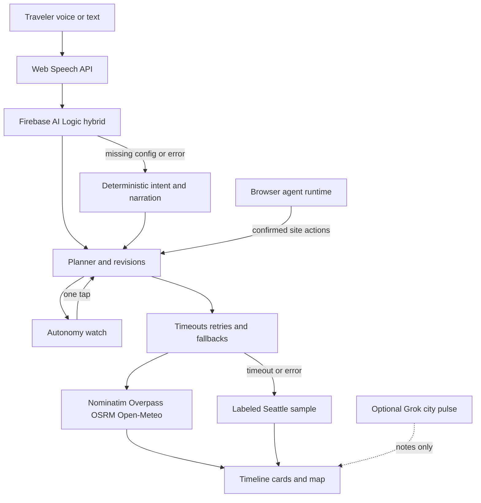

# Architecture

Voice Trip Concierge keeps planning deterministic and testable. Models explain and narrate. They do not invent the stops.

## Runtime paths

| Path | Role |
| --- | --- |
| `lib/hybrid-ai.ts` | Firebase AI Logic. `PREFER_ON_DEVICE`, then cloud Gemini. Single-turn JSON for intent and short text for narration. Badge uses `inferenceSource` and measured latency. |
| `lib/intent.ts`, `lib/narration.ts` | Deterministic fallback. No network. |
| `lib/planner.ts`, `lib/revisions.ts` | Multi-day stops, times, and one-stop edits. |
| `lib/autonomy.ts`, `lib/opening-hours.ts` | Closed hours, rain on outdoor stops, legs over 40 minutes. |
| `lib/resilience.ts` | Timeout, retry with backoff, then a fallback value. |
| `lib/seattle.ts` | Labeled sample used by the button and by failed live calls. |
| `app/api/*` | Server proxies with a named User-Agent. The xAI key never reaches the browser. |
| `public/runtime/` | Cognizant MVP runtime. Validates the network, runs agents, confirms writes, consents before peer fetches, and drops private context unless a field is allow-listed. |

## Agent network

`agent-manifest.json` is the public index. `voice_trip_concierge.network.json` is the front network: `front_desk` delegates to `planner_specialist`, `autonomy_watch`, and `narrator`. `links.json` points `city_notes` at the second published network. The Agents tab loads `/runtime/index.js` behavior by importing that runtime, and other sites can fetch the JSON because those files send `Access-Control-Allow-Origin: *`.

The default agent router is local and free. The bring-your-own-key form is hidden unless `NEXT_PUBLIC_ENABLE_EXTRA_AI` is exactly `true`. The live site leaves that flag unset, so the Agents tab stays on the deterministic router. When the flag is on, a visitor may save an OpenAI-compatible base URL, model, and key in `localStorage`. That key is attached only to the router request. Trip planning still uses Firebase AI Logic.

## Self-healing

Every upstream call has a timeout and retries. Nominatim or Overpass failure replaces the trip with the Seattle sample and says so. OSRM failure keeps the places and labels drive times as estimates. Open-Meteo failure pauses rain checks. Grok is not called unless `NEXT_PUBLIC_ENABLE_EXTRA_AI` is `true`. When that flag is on, a Grok failure only clears the city-pulse card. Firebase failure keeps the local parser. A React error boundary replaces a crashed tree with a retry button instead of a blank page.

## Tests

`npm test` runs Vitest in Node. It does not call Nominatim, Overpass, OSRM, Open-Meteo, Firebase, or xAI. Covered: multi-day plans, one-stop revisions, autonomy proposals, opening hours, the Seattle fallback, the saved-trip morning check, the extra-AI flag staying off, retry and timeout behavior, intent questions, and the agent runtime (validation, declined writes, peer consent, private context, budgets, and cycles).
